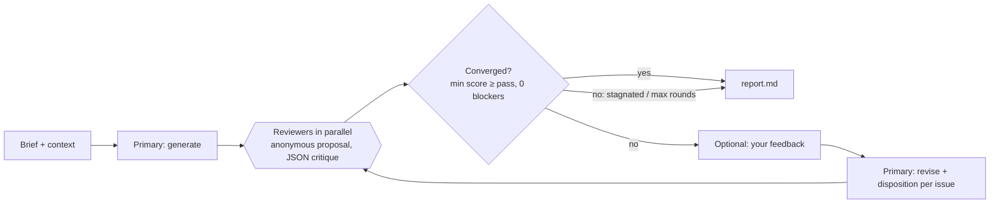

# ideation-loop

A primary AI writes a proposal. Secondary AIs review it adversarially. The primary revises and must answer every issue. The loop repeats until the reviewers converge, the scores stop improving, or the round limit is hit. Then you decide.

It drives the vendors' official CLIs, signed in with your own accounts, so it needs no API keys and doesn't touch browser pages.



## Setup

```bash
npm install
cp config.example.json config.json   # edit primary/secondaries
npm run demo                          # offline smoke test with mock providers
npm test                              # unit + loop tests, offline, no quota used

# Sign in to each CLI once (they use your consumer accounts):
claude            # Claude Code (Pro/Max)
agy               # Google Antigravity CLI (Google login)
codex login       # Codex CLI (ChatGPT login; check your plan's Codex quota)
```

## Use

```bash
npx tsx src/cli.ts run --brief @brief.md --context @constraints.md -i
npx tsx src/cli.ts resume <runId>        # after a quota pause or failure
npx tsx src/cli.ts report <runId>
npx tsx src/cli.ts run --brief "..." --primary agy --reviewers claude,codex --rounds 4
```

To get a plan you already have reviewed as written, pass it with `--proposal` and stop after one round:

```bash
ideate run --proposal @plan.md --rounds 1     # the reviewers critique plan.md; the primary writes nothing
```

`--proposal` makes your text round 1's proposal, so the primary is not asked for one, and `--brief` becomes optional. With more than one round the primary revises your text against the reviews as usual. In Claude Code, the `/ideate-review` command in this repo runs this on the plan in your session.

You can also build once with `npm run build`, then run `node dist/cli.js ...` or `npm link` and use `ideate ...`.

`-i` pauses after each review round. Press Enter to continue, type feedback (it reaches the primary as the top-priority input), or type `q` to stop.

Exit codes: `0` converged · `2` needs a human decision (max rounds, stagnated, stopped) · `75` paused on quota · `1` error.

## Managing ideas

Each run is one idea. Give it a name with `--title` (otherwise the brief's first line is used).

```bash
ideate list                      # your ideas, newest first; branches listed under their parent
ideate continue                  # pick an idea with the arrow keys and continue it
ideate issues 3                  # past issues of idea #3, with refs for --reopen
```

Continuing an idea runs more rounds on it, even if it had already converged or stopped, and lets you push it in new directions:

- **New scenarios** (`--scenario "Two CHWs share one phone"`) become part of the idea. Claude and the reviewers see them in every later round, marked NEW in the round they were added, and reviewers raise an issue for any scenario the proposal doesn't handle. Edit or remove them later with `--edit-scenario S1=...` or `--remove-scenario S1`.
- **Reopened issues** (`--reopen r2:agy:CORR-1`) bring back a past issue, for example one Claude rejected. Claude must answer it, and the reviewers see its answer the round after.
- **Branching** (`--from-round 2`) starts a new run from round 2's proposal and reviews, leaving the original as it was.
- `--note` sends Claude one-time feedback before its next revision; `--more N` sets how many rounds to run (default 2).

Without a run, `ideate continue` asks for all of these step by step; Esc cancels without changing anything. Numbers in `ideate list` follow creation order, so they don't change when you continue an idea. Use `resume` to retry a run that failed, paused on quota, was stopped, or was cut off (for example by a crash).

`continue -i --note "..."` still shows the `-i` prompt after the review. Claude gets both the note and what you type there.

`continue` and `resume` refuse an idea that is still running, so two processes never work on the same idea. Branching with `--from-round` is allowed, because it starts a new run. Ctrl-C in the terminal, or Stop in the app, cancels the agent call in progress, saves what is finished and ends the run as `stopped`; you can `continue` or `resume` it later.

## Chat UI

The same loop as a chat app in your browser:

```bash
npm run build && npm link   # once, and again after pulling changes
ideate ui                   # opens http://127.0.0.1:4317; --port <n> to change it, --no-open to skip the browser
```

Type a brief to start an idea; the settings button next to it sets the rounds and reviewers. Each agent's text appears as it is written. Claude and agy stream as they go; Codex shows its answer in one piece when it is done. agy may also send its text in one burst late in its call rather than word by word. While an idea is running, a message you send (a note, a new scenario, a reopened issue, extra rounds) is queued and used in the next revision. When it is idle, sending a message continues it. You can also stop, resume, branch from a round, rename an idea and open its report.

Live text needs the streaming settings from `config.example.json`. If your `config.json` predates them, copy each provider's `args` and its `"stream"` key (and agy's `"input": "stream-json"`) from `config.example.json`; without them the app still works, but each agent's text appears only when its call finishes.

Nothing is lost when you close the tab. Drafts you haven't sent are kept in the browser too, per idea, so switching ideas or reloading doesn't lose them. Every idea started from the app runs in its own background process that writes everything to `runs/<id>/`, including each agent's text as it streams (`live.jsonl`). Closing the tab, the browser crashing, or stopping `ideate ui` with Ctrl-C doesn't stop a run. Open the app again and the conversation is replayed from those files, then carries on live. If a run's process is killed (say, the machine restarts), the idea shows as interrupted with the text written so far; Resume picks it up from the last finished step.

Runs started in a terminal with `ideate run` or `ideate continue` show up in the app too, and you can watch them live.

The server listens on 127.0.0.1 only and refuses requests from other sites. It has no login: anyone with an account on your machine can use it.

To work on the front end, run `ideate ui --no-open` and `npm run dev:ui` side by side. Vite serves the app with hot reload and forwards `/api` to the server on port 4317.

## Outputs (`runs/<id>/`)

| File | Contents |
|---|---|
| `report.md` | Score trajectory, open issues from the latest review, scenarios, issues you reopened, feedback the primary rejected or never answered, final proposal (flagged if it hasn't been reviewed yet) |
| `round-N/proposal.md` | The proposal that was reviewed in round N |
| `round-N/review-<provider>.json` | Structured critique |
| `round-N/revision.json` | Revised proposal + accepted/partial/rejected per issue |
| `raw/transcript.jsonl` | Every prompt and raw response |
| `state.json` | Checkpoint used by `resume` |
| `live.jsonl` | Every agent call and its text as it streamed, for the chat UI |
| `inbox.jsonl` | Messages queued from the chat UI for the next revision |
| `worker.json` | The process working on the idea right now (removed when it ends) |
| `worker.log` | Output of background processes started from the chat UI |

## Design decisions

- **Anonymous proposals.** Reviewers aren't told which model wrote the proposal, and the primary sees "Reviewer A/B", not vendor names. Attribution makes critique softer and invites deference to brands.
- **Forced dispositions.** The primary must accept, partially accept or reject each issue, with a rationale. If it skips any, it is asked once more for just those; anything still unanswered is listed in the report. It isn't pushed to accept everything either. The report lists rejected issues for you to check.
- **Reviewers can push back.** In the next round each reviewer sees its own previous issues alongside the author's response to each, and can re-raise an issue if the rejection is weak or the author didn't respond.
- **Bounded loop.** The loop stops on convergence, on stagnation (the mean score doesn't improve by `minDelta` per round), or at `maxRounds`. When the models disagree, the decision comes to you; the tool doesn't average the scores to declare agreement.
- **Checkpointing on every call.** If one reviewer hits its quota while another succeeded, resuming re-runs only the missing review. The checkpoint is written to a temp file and renamed, so a crash can't corrupt it. `resume` keeps the run's original primary and reviewers.
- **Separate working directory per call.** Each CLI call runs in its own empty temp directory, deleted afterwards. A CLI doesn't pick up the repo you launched from, or files another call left behind. See "Tool access" below for what this does and doesn't protect.
- **Malformed JSON gets one repair attempt.** If the repair also fails, the run stops and can be resumed.
- **Errors reported with exit code 0 are caught.** If a CLI exits 0 but its JSON output marks an error (Claude Code's `is_error`, `subtype: error_*` or `api_error_status`; agy's non-`SUCCESS` `status`; an `error` field), or reports success with an empty response, the call fails instead of the error text being used as a proposal. Usage-limit messages pause the run for `resume`.

## Adding a provider

Any CLI that reads a prompt and prints text works:

```json
"ollama": { "type": "command", "cmd": "ollama", "args": ["run", "qwen2.5:14b"], "input": "stdin" }
```

Prefer `input: "stdin"`. CLIs that only take stdin as structured messages, like agy, use `input: "stream-json"`: the prompt is sent as one `{"event":"user","message":{"content":"…"}}` line, and the final `{"event":"result",…}` line of the output is read. `input: "arg"` replaces `{prompt}` in `args`, but revision prompts carry the full proposal plus every review and soon pass Linux's 128 KiB per-argument limit; they are also visible to other users in `ps`. The tool refuses argument prompts over 120 KiB with a message telling you to switch to stdin.

## Tool access

The working directory is not a sandbox. These CLIs are agents, and one with file or shell tools can still read absolute paths such as `~/`. The example config restricts each one as far as its flags allow:

| Provider | Flags | What it can still do |
|---|---|---|
| claude | `--tools "" --strict-mcp-config` | Nothing: no built-in tools, no MCP servers |
| codex | `--sandbox read-only --ephemeral` | Run read-only shell commands, which can read any file your user can. Codex has no flag to turn its shell off |
| agy | `--sandbox --disable-slash-commands` | Headless mode auto-denies tools that need approval, including shell commands and reading files outside the (empty) working directory. A call where the model only tried denied tools fails with "empty response — denied tools: …" |

For real isolation, run the whole tool in a container or as a separate OS user.

## Caveats

- **Data.** Free tiers (Google accounts, ChatGPT Free/Go) may use your prompts for training. Don't put partner, government or patient data through this tool.
- **CLI flags drift.** If a vendor changes its CLI, fix it in `config.json`; no code change is needed.
- **Reviewer quality matters more than primary quality.** A weak reviewer approves weak ideas. Put your strongest model where its judgement counts most.
